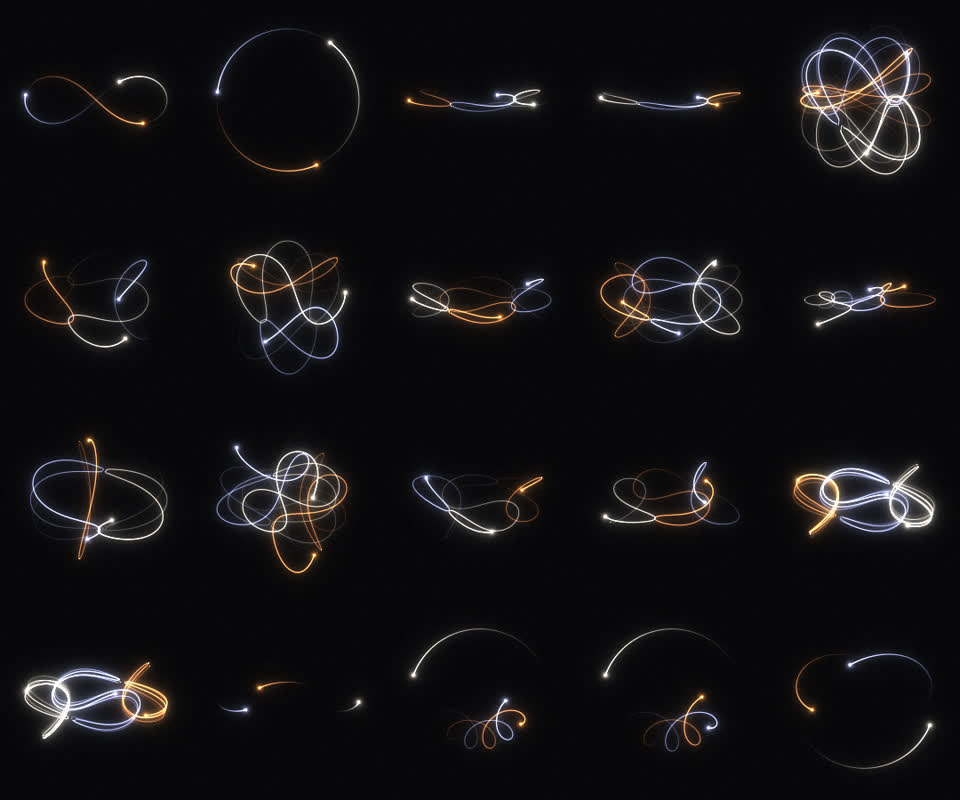
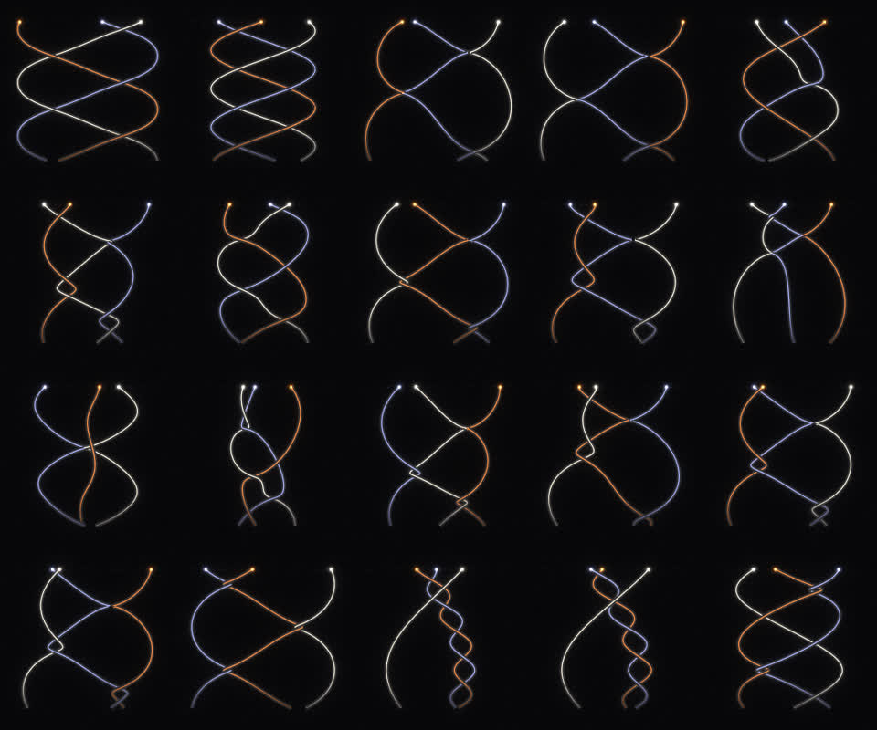
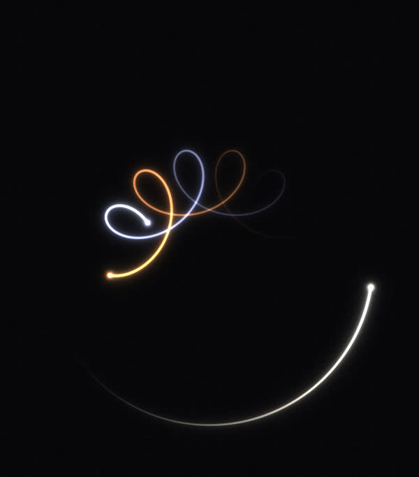

# Three-Body Orbits

An interactive gallery of **periodic solutions of the planar Newtonian three-body problem**, rendered as glowing trails in the browser — plus a *braid* view that unrolls each orbit along a time axis.



It plays three published catalogues:

| Collection | Orbits | Source |
|---|---|---|
| **Classic** | 20 famous orbits: figure-eight, Lagrange, Šuvakov–Dmitrašinović butterflies & moths, Broucke | Moore 1993; Chenciner & Montgomery 2000; Šuvakov & Dmitrašinović, *PRL* 110, 114301 (2013); Broucke 1975 |
| **Li & Liao** | 2,044 zero-angular-momentum orbits (695 equal-mass, 1,349 with m₃ ∈ {0.5 … 10}) | Li & Liao, *Sci. China PMA* 60, 129511 (2017); Li, Jing & Liao, *PASJ* 70, 64 (2018) — [sjtu-liao/three-body](https://github.com/sjtu-liao/three-body) |
| **Free-fall** | 24,582 initial conditions = 12,409 distinct collisionless free-fall orbits (236 self-dual) | Hristov, Hristova, Dmitrašinović & Tanikawa, *Celest. Mech. Dyn. Astron.* 136, 7 (2024), [arXiv:2308.16159](https://arxiv.org/abs/2308.16159) — [data](http://db2.fmi.uni-sofia.bg/3bodyfree/) |

## Run it

No build step and no dependencies — open `app/index.html` in a browser (works from `file://`), or serve the folder:

```sh
python3 -m http.server -d app 8000   # then open http://localhost:8000
```

**Deploy:** it's a static site. On Vercel, import the repo as-is — `vercel.json` serves the `app/` folder with no build step. On GitHub Pages, publish from `main` and open `/app/`.

## Features

- **Grid of live orbits** — any rows × columns, paging/shuffling through each catalogue, filters (mass ratio, symmetry class, self-dual, T* range) and sorting (T*, word length, Lyapunov exponent, random).
- **Braid view** (`B`) — each body becomes a world-line: position projected on an adjustable axis (→) against time (↑). The bodies ride a "now" line while their history scrolls down; at every crossing the strand nearer the viewer passes over, as in a braid diagram. The time window is in scale-invariant time t\* so every cell scrolls at the same rate.
- **Inspector** (click a cell) — full-precision initial conditions, period, T\* = T|E|³ᐟ², energy, Lyapunov exponent, dual i.c.; an Agekyan–Anosova domain map of all 24,582 free-fall i.c.s (click to load the nearest, or simulate any point); a **stability test** that nudges a body by 10⁻ⁿ and integrates several periods; and a **custom initial-conditions** editor (masses, positions, velocities).
- **Look** — palettes (incl. custom), trail length/width, glow, body size (scaled by m¹ᐟ³), ghost path, equal-duration or T\*-proportional loops.
- **Export** — PNG snapshot or a WebM/MP4 recording of one full loop.

Keys: `Space` pause · `S` settings · `B` braids · `←`/`→` page · `Esc` back.

<p align="center"> </p>

## How it works

**Integrator** (`app/physics.js`). The orbits are extremely unstable (the free-fall catalogue reports Lyapunov multipliers up to e³⁰ per period) and pass through near-collisions down to ~10⁻⁸, so a plain Runge–Kutta drifts or stalls. The app uses *algorithmic regularization* (Mikkola & Tanikawa 1999): a logarithmic-Hamiltonian leapfrog — exact for Kepler motion — in **chain coordinates** (relative vectors along the two shortest edges, so a close pair keeps full double precision), driven by **Gragg–Bulirsch–Stoer** extrapolation with adaptive step and exact landing on a target time.

- *Free-fall orbits* start at rest and come to rest again at T/2, after which the motion retraces itself. Only [0, T/2] is integrated and the second half is the mirror image — the loop is exactly periodic. Typical residual speed at T/2: ~10⁻⁷.
- *Li & Liao orbits* are integrated to their published T (10 digits); all 2,044 return to their initial state within 6·10⁻⁵.
- *Classic orbits* (initial conditions given to fewer digits) have their period refined to the closest phase-space return, and the tiny residual is removed linearly so the loop is seamless.

Each orbit takes ~1–10 ms to compute; cells are filled a few per frame.

**Renderer** (`app/gl-trails.js`). Trails are continuous WebGL triangle strips with per-vertex width and brightness (smooth taper, Catmull–Rom-resampled positions, rounded head) and an anti-aliased core evaluated per pixel. Glow is a bloom post-process — the scene is Gaussian-blurred at ½, ¼ and ⅛ resolution and added back — so tight hairpin turns never fold. Braids are drawn back-to-front with a depth buffer: each strand carries a dark outline sitting just behind it, which cuts the strands further back but never itself. A Canvas 2D fallback is used when WebGL is unavailable.

## Project layout

```
app/
  index.html, style.css   UI
  main.js                 collections, grid, inspector, braid view, export
  physics.js              regularized integrator (also loadable from Node)
  gl-trails.js            WebGL trail / braid / bloom renderer
  classics.js             initial conditions of the classic gallery
  orbits-data.js          Hristov et al. free-fall catalogue (generated)
  liao-data.js            Li & Liao catalogues (generated)
scripts/
  build-data.js           regenerate the two data files from the published sources
  test-physics.js         regression checks of the integrator against the catalogues
docs/                     screenshots
```

```sh
npm test               # node scripts/test-physics.js  (Node 18+)
npm run build-data     # re-download and rebuild app/*-data.js (byte-identical output)
```

## License & data credits

Code: [MIT](LICENSE). The orbit catalogues belong to their authors (see the table above); this project only re-packages the published initial conditions in a compact form and cites them in the generated files. Please cite the original papers if you use the data.
